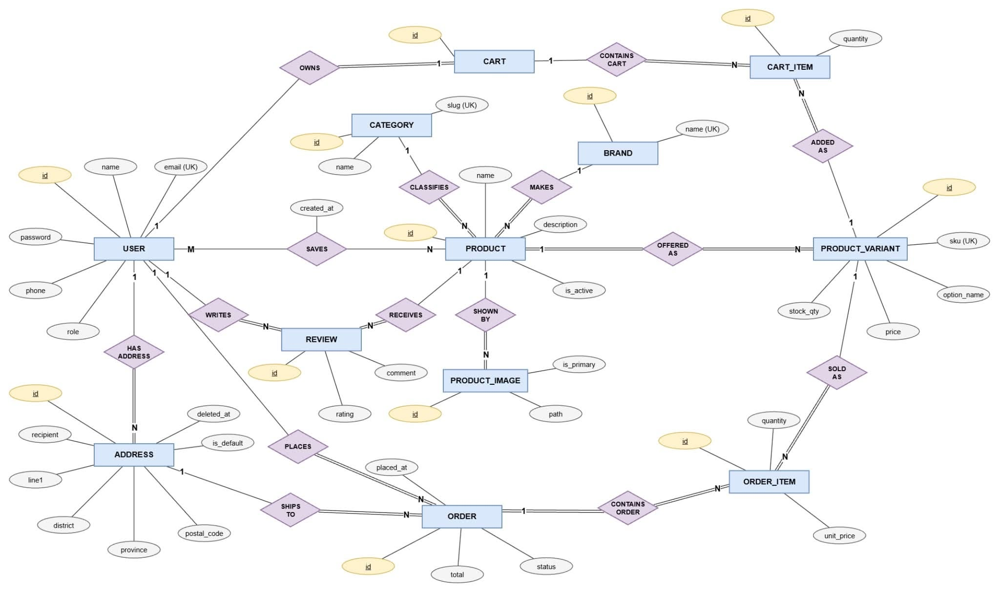
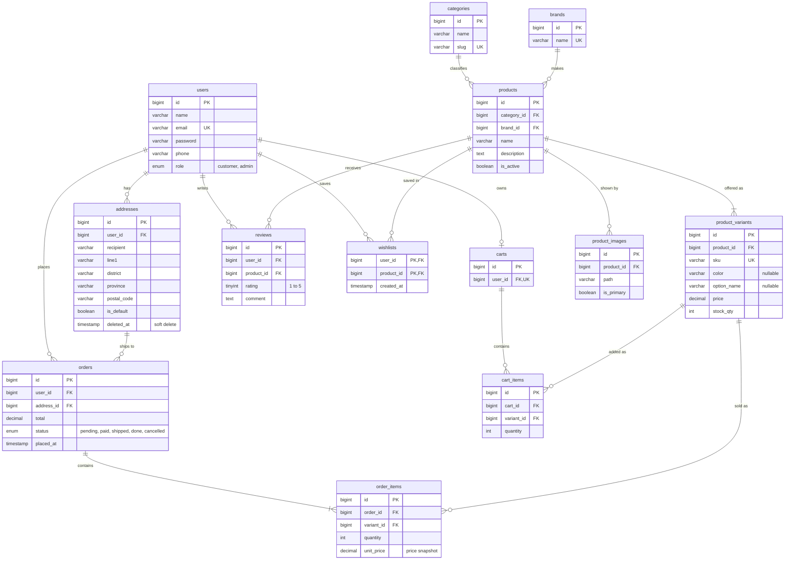

# ER Diagram

Database: MySQL 8.4, schema `badminton_shop`. Chen notation: rectangles are entities, diamonds are relationships, ellipses are attributes. Gold underlined = key, double border = weak entity, double line = total participation, `1` / `N` / `M` = cardinality.

Image: [`images/ERdiagram.jpg`](images/ERdiagram.jpg). The table-level view (columns, keys, foreign keys) is in [schema-design.md](schema-design.md). A crow's-foot version of the same model is kept in [`er.mmd`](er.mmd) (Mermaid) and at the bottom of this page.

Conceptual notes: `PRODUCT_IMAGE` is a weak entity (it has no meaning without its product; `path` is its partial key). `IN_CART`, `ORDER_LINE`, `SAVES` and `REVIEWS` are many-to-many relationships whose attributes (`quantity`, `unit_price`, `rating`, `comment`) become the columns of `cart_items`, `order_items`, `wishlists` and `reviews`. `location` on `ADDRESS` is a composite attribute stored as `line1`, `district`, `province`, `postal_code`.

## Entities and relationships

| Relationship | Cardinality | Meaning |
|---|---|---|
| users – addresses | 1 : N | A user keeps many shipping addresses. |
| users – carts | 1 : 0..1 | One cart per user (`carts.user_id` is unique). |
| users – orders | 1 : N | A user places many orders. |
| addresses – orders | 1 : N | An order ships to one address. |
| categories – products | 1 : N | A product belongs to one category. |
| brands – products | 1 : N | A product belongs to one brand. |
| products – product_variants | 1 : 1..N | A product has at least one variant (colour, size, weight, grip). Price and stock live on the variant. |
| products – product_images | 1 : N | Several images, one marked primary. |
| carts – cart_items – product_variants | M : N | A cart holds many variants, a variant sits in many carts. `cart_items` carries `quantity`. |
| orders – order_items – product_variants | M : N | Same pattern. `order_items` carries `quantity` and `unit_price`. |
| users – wishlists – products | M : N | Wish list. Composite key (`user_id`, `product_id`), no surrogate id. |
| users – reviews – products | M : N | A user reviews a product once (unique pair). Carries `rating` and `comment`. |

## Design decisions

- **Variants.** Rackets differ by weight and grip, shoes by size. Price and stock belong to the variant, so cart and order lines point at `product_variants`, not `products`.
- **Price snapshot.** `order_items.unit_price` copies the price at purchase time, so later price changes never alter old orders.
- **Soft-deleted addresses.** `addresses.deleted_at` lets a user remove an address while old orders still reference it.
- **Wish list on product, not variant.** Customers save the item they like, not a specific size.
- **Roles.** `users.role` (`customer` / `admin`) instead of a separate admin table.
- **Reviews limited to buyers.** Enforced in application code by checking `order_items`.
- Audit columns `created_at` / `updated_at` exist on every table but `wishlists` (only `created_at`). They are left out of the diagram to keep it readable.
- Laravel framework tables (`sessions`, `cache`, `jobs`, `password_reset_tokens`, `migrations`) are not part of the domain model and are omitted.

## Mermaid source (crow's-foot version)

