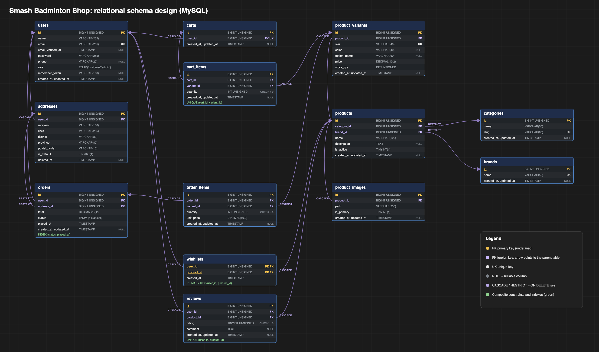

# Schema Design

Relational schema of the MySQL database `badminton_shop`: tables, columns, keys and foreign keys with their `ON DELETE` rules.

Files: [`schema-design.png`](schema-design.png), [`schema-design.svg`](schema-design.svg) (vector). Regenerate with `python3 docs/src/schema_design.py`.

How to read it:

- Gold underlined column = primary key. Purple = foreign key; the arrow points to the parent table's `id`. `UK` = unique.
- Green lines under a table are composite constraints: `UNIQUE (cart_id, variant_id)` on `cart_items`, `UNIQUE (user_id, product_id)` on `reviews`, composite primary key on `wishlists`, index on `orders (status, placed_at)`.
- `CASCADE` / `RESTRICT` is the `ON DELETE` rule of that foreign key. Order history is protected (`RESTRICT`), personal and child data goes with its parent (`CASCADE`).
- Audit columns `created_at, updated_at` are grouped on one line per table.

The full column list with types, defaults and checks is in [relational-mapping.md](relational-mapping.md), and the ER model it is derived from is in [er-diagram.md](er-diagram.md).
